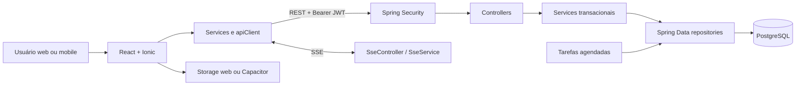
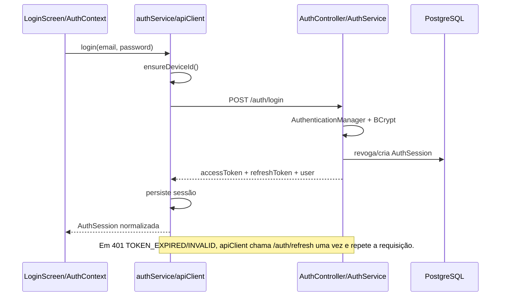
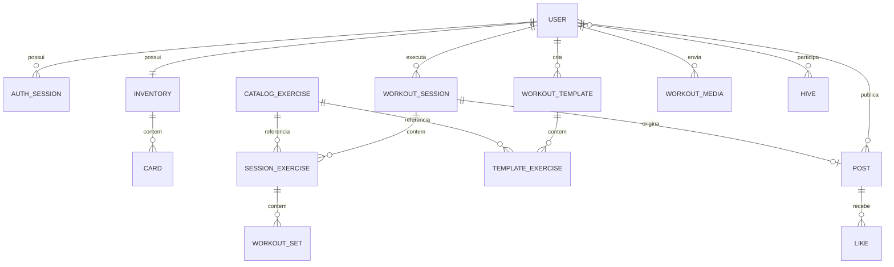

# Architecture

> Documento compartilhado e replicado nos repositórios `frontend` e `backend`.
> Os caminhos usam o layout em que ambos ficam co-localizados; em um clone
> isolado, o prefixo do repositório atual representa a própria raiz.

## 1. Purpose

Este documento descreve a estrutura que existe hoje no BeeFit, as fronteiras entre cliente, API e persistência, e as regras que mudanças futuras devem preservar. Ele não substitui instruções de execução dos READMEs, diretrizes visuais, contratos detalhados de autenticação nem o plano de testes.

As afirmações abaixo são tratadas como **fato** quando confirmadas por código ou configuração, como **convenção observada** quando aparecem repetidamente sem fiscalização formal, e como **não determinada** quando o repositório não oferece evidência suficiente.

## 2. System overview

BeeFit é um sistema cliente-servidor para registrar treinos, manter perfil e sequência semanal, publicar treinos, gerenciar amizades e grupos (“Colmeias”), gerar cartas de desempenho e oferecer moderação administrativa. Os consumidores observáveis são usuários autenticados do aplicativo e usuários com papel `ADMIN`.

Há dois projetos co-localizados, com históricos Git próprios e sem build agregador na raiz:

- `frontend/`: React 19 + TypeScript + Vite, Ionic React e Tailwind; gera aplicação web e é empacotado para Android/iOS com Capacitor.
- `backend/`: aplicação Java 25, Spring Boot 4, Spring MVC/Security/Data JPA, Hibernate, Flyway e PostgreSQL.

Em runtime, o cliente usa REST para comandos/consultas e um stream SSE para atualizações sociais. A API executa regras de negócio, persiste o estado e também roda tarefas agendadas.

## 3. Architectural summary

O backend é um único processo implantável, organizado predominantemente por camada técnica (`controller`, `service`, `repository`, `domain`, `dto`). Ele é melhor descrito como um monólito em camadas com áreas funcionais, não como módulos isolados. As entidades dependem diretamente de JPA, Bean Validation e, no caso de `User`, Spring Security; portanto, não há evidência de Clean Architecture, Hexagonal ou domínio independente de framework.

O frontend combina organização por funcionalidade em `components/<feature>/` com serviços e tipos compartilhados. Views chamam hooks; hooks e alguns componentes coordenadores chamam services; services normalizam contratos REST. `AuthContext` e `App` concentram estado transversal, enquanto os demais estados são locais a hooks/componentes e a adaptadores de armazenamento.



As fronteiras externas atuais são HTTP/SSE, armazenamento do dispositivo/navegador, câmera/sistema de arquivos nativo e PostgreSQL. Não foi encontrada mensageria, cache distribuído ou chamada HTTP do backend para terceiros.

## 4. Repository topology

```text
./
├── AGENTS.md
├── PRE_PUBLICACAO_BEEFIT.md
├── backend/
│   ├── pom.xml, mvnw, docker-compose.yml
│   ├── docs/testing/
│   └── src/
│       ├── main/java/com/beefit/api/
│       │   ├── controller/  # endpoints REST/SSE
│       │   ├── service/     # orquestração e regras de negócio
│       │   ├── domain/      # entidades JPA e enums
│       │   ├── dto/         # contratos HTTP/eventos
│       │   ├── mapper/      # conversões de contratos
│       │   ├── repository/  # Spring Data JPA e queries
│       │   ├── exception/   # erros e advice global
│       │   ├── infra/       # segurança e seed
│       │   └── utils/log/   # auditoria via AOP
│       ├── main/resources/  # configuração, migrations e seed
│       └── test/            # testes Java e profile de teste
└── frontend/
    ├── package.json, vite.config.ts, capacitor.config.ts
    ├── android/, ios/
    ├── docs/, guidelines/
    └── src/
        ├── main.tsx
        ├── app/
        │   ├── auth/        # AuthContext
        │   ├── components/  # telas, features e UI compartilhada
        │   ├── hooks/       # estado transversal da aplicação
        │   ├── services/    # REST/SSE e normalização de contratos
        │   ├── storage/     # persistência local/nativa
        │   ├── platform/    # câmera, arquivos e validação de mídia
        │   ├── types/       # modelos internos compartilhados
        │   └── mocks/       # taxonomia/dados locais remanescentes
        ├── styles/
        └── test/setup.ts
```

Arquivos HTTP do backend pertencem em `controller`; regras e transações, em `service`; queries, em `repository`; contratos, em `dto`. A exceção atual é `ExerciseCatalogController`, que consulta `CatalogExerciseRepository` diretamente e expõe `CatalogExercise`.

No frontend, uma feature estruturada usa `components`, `hooks`, `types`, `utils` e `constants` dentro de sua pasta. Componentes genéricos ficam em `components/ui` ou nos componentes `Bee*`; chamadas remotas ficam em `services`, não nas views. Há telas antigas/coordenação em arquivos planos de `components`, logo a organização por feature é predominante, não universal.

## 5. Applications, packages and runtime components

### Frontend web/mobile

- **Finalidade/local:** interface do usuário em `frontend/`.
- **Entrada:** `src/main.tsx` monta `AuthProvider` e `App` em `#root`.
- **Execução:** `npm run dev`; `npm run build` gera `dist/`; `npm run mobile:sync` sincroniza o bundle com Android/iOS.
- **Dependências centrais:** React, Ionic, Capacitor, Tailwind/Radix e `fetch`.
- **Comunicação:** REST e SSE com a API; Secure Storage/Preferences/Filesystem em nativo e `localStorage` no navegador.
- **Implantação:** web e shells nativos são construíveis separadamente. O destino e pipeline reais não puderam ser determinados.

### API backend

- **Finalidade/local:** API REST, SSE, jobs e persistência em `backend/`.
- **Entrada:** `BeefitApiApplication`, com `@SpringBootApplication` e `@EnableScheduling`.
- **Execução:** `./mvnw spring-boot:run`; o plugin Spring Boot gera o artefato Maven.
- **Dependências centrais:** Spring MVC/Security/Data JPA, Hibernate, Flyway, PostgreSQL, MapStruct, Lombok e Auth0 Java JWT.
- **Comunicação:** recebe HTTP do frontend e usa PostgreSQL. Não há cliente HTTP de saída no código backend.
- **Implantação:** é um único artefato. Não foi encontrada configuração de deploy ou CI/CD.

### Infraestrutura de desenvolvimento

`backend/docker-compose.yml` fornece PostgreSQL 16 e pgAdmin. O suporte Docker Compose do Spring inicia/para esses serviços no profile padrão; `application-prod.yaml` desativa essa integração. O Compose é infraestrutura local, não evidência de topologia de produção.

## 6. Main modules and bounded areas

Os nomes abaixo são áreas funcionais observadas, não bounded contexts DDD formais.

- **Autenticação e sessão:** `AuthController`, `AuthService`, `TokenService`, `SecurityFilter`, `AuthSession`, `authService.ts`, `apiClient.ts`, `AuthContext`. Produz JWT, refresh token e usuário normalizado.
- **Perfil e conta:** `ProfileController`/`UserService` e a feature `components/profile`. Inclui perfil público, calendário de treinos, ghost mode, senha e exclusão da conta.
- **Treino e catálogo:** `WorkoutController`, `WorkoutSessionService`, entidades `WorkoutSession`/`SessionExercise`/`Set`, catálogo e feature `active-workout`. Recebe snapshots completos ao finalizar.
- **Templates:** `WorkoutTemplateController/Service` e `WorkoutTemplate`/`TemplateExercise`; cria, edita e importa treinos a partir de posts.
- **Social:** amizades, feed/posts/likes, perfis públicos e SSE em `Friendship*`, `Post*`, `Sse*` e nas features `social`/`social-feed`.
- **Colmeias:** `HiveController/Service/Repository` e feature social; grupos de até duas participações por usuário, com ranking por treinos no período.
- **Gamificação:** `CardService`, `InventoryService`, `HoneysScheduleService`, `Card`, `Inventory` e feature `inventory`. Uma conclusão pode gerar no máximo uma carta: cada exercício é comparado somente com seu próprio histórico, usando 1RM estimado quando há carga e repetições quando não há. A primeira execução estabelece a referência e não gera carta; melhoras abaixo de 3% também não geram. Entre os exercícios elegíveis, vence a maior melhora percentual, com raridades `COMMON` (3%–7,49%), `RARE` (7,5%–14,99%), `EPIC` (15%–24,99%) e `LEGENDARY` (a partir de 25%). Um Honey e o progresso da meta semanal aumentam no máximo uma vez por dia civil, no primeiro treino finalizado com duração mínima de 30 minutos. A rotina diária zera a ofensiva quando a quantidade de dias restantes na semana já não permite atingir a meta; na segunda-feira, apenas o contador semanal é reiniciado.
- **Mídia:** `WorkoutMediaController/Service`, tabela `workout_media`, carregamento autenticado no frontend e adaptadores `platform/`. Armazena bytes no PostgreSQL e autoriza leitura conforme dono, perfil, post, amizade, privacidade, modo fantasma e papel administrativo.
- **Rate limiting:** `RateLimitService/Repository` protege operações sensíveis com contadores atômicos compartilhados na tabela `rate_limit_buckets`; identificadores são persistidos somente como hash SHA-256.
- **Administração:** controllers/services administrativos, `AdminScreen` e auditoria `@LogAudit`. Administra usuários, banimentos, métricas e posts.

Essas áreas compartilham entidades, services e o mesmo banco; não possuem APIs internas ou limites de compilação próprios.

## 7. Request and execution flows

### Requisição REST autenticada

1. Um service frontend chama `apiClient` com `auth: true`.
2. `apiClient` lê o access token em `sessionStorage`, define `Authorization`, aplica timeout de 15 segundos e serializa JSON/FormData.
3. `SecurityFilter` valida assinatura, issuer e expiração do JWT, carrega o usuário por e-mail e popula o `SecurityContext`.
4. O controller recebe `@AuthenticationPrincipal User` e DTOs; `@Valid` executa Bean Validation quando presente.
5. Normalmente um service aplica propriedade, estado e regras de negócio, abre transação e usa repositories.
6. Mappers ou construção manual convertem entidades para DTOs. `GlobalExceptionHandler` converte exceções conhecidas em `ErrorResponse`.

### Login e renovação



O refresh token aleatório é persistido apenas como hash SHA-256 no backend e rotacionado no refresh. Logout revoga a sessão correspondente e sempre limpa o estado local, mesmo se a chamada remota falhar.

### Início e finalização de treino

1. `WorkoutStartScreen` carrega catálogo/templates, tenta recuperar `/api/workout/active` e mescla o draft local quando o ID coincide.
2. `/api/workout/start` impede uma segunda sessão `IN_PROGRESS`, valida template do próprio usuário e persiste os exercícios iniciais vindos do template ou do request; depois salva a sessão e emite presença SSE se pública.
3. Durante o treino, o hook mantém séries e exercícios adicionados posteriormente no draft local em `workoutDraftStorage`; novos grupos são sincronizados por endpoint próprio.
4. Na finalização, a UI valida título/séries, congela `finishedAt` e `Idempotency-Key`, persiste o snapshot e a foto e, após o upload opcional, persiste também o `photoMediaId` antes de enviar o comando final.
5. `WorkoutSessionService.finishWorkout` bloqueia a linha com `PESSIMISTIC_WRITE`, valida dono/estado/chave, reconcilia exercícios e séries, calcula duração, calorias e volume, gera carta/inventário, atualiza contadores e opcionalmente cria post e consome mídia. Índices parciais garantem uma sessão ativa e uma chave de finalização por usuário mesmo sob concorrência.
6. A transação força o flush antes de emitir eventos de carta/presença. Em falha o frontend mantém o payload exato; ao reiniciar, voltar à rede ou autenticar novamente, consulta a sessão específica, reconhece uma conclusão já confirmada ou repete automaticamente o mesmo comando.

Os eventos SSE são efeitos em memória executados durante os métodos transacionais; não existe outbox. Assim, entrega do evento e commit do banco não formam uma unidade durável.

### Feed e eventos sociais

`GET /api/posts/feed` consulta posts do usuário e de amizades aceitas, excluindo posts removidos e, para terceiros, autores em modo fantasma ou treinos privados. A mesma regra restringe curtidas, importação de template e listagem de posts por perfil. O frontend pagina via hook. Uma única conexão SSE compartilhada no módulo `socialEventsService` distribui eventos a listeners de feed, amizade, inventário e treino; o cliente reconecta após aproximadamente um segundo, sem cursor ou replay.

## 8. Layer responsibilities

### Backend

- **Controllers:** definem paths, status, paginação, headers e autenticação principal. Devem permanecer finos segundo o padrão majoritário. Hoje também há parsing de filtros em `InventoryController` e consulta direta em `ExerciseCatalogController`.
- **Services:** concentram validações de negócio, propriedade, composição entre áreas, transações e efeitos SSE. Services podem chamar repositories, mappers e outros services.
- **Domain:** entidades de persistência com relacionamentos e alguns helpers/invariantes (`Inventory.addCard`, contadores de `Post`, helpers de `WorkoutSession`). Não é uma camada independente do framework.
- **DTOs/mappers:** DTOs Java records definem entrada, saída e eventos. MapStruct é usado em parte; outros mapeamentos são manuais nos services/controllers.
- **Repositories:** interfaces Spring Data, query methods e JPQL; não contêm regras de apresentação.
- **Infra/security/database:** filtro/configuração de segurança e seed inicial. Não há um conjunto genérico de adapters/ports.
- **Exceptions/advice:** exceções por área e tradução global para HTTP.

### Frontend

- **`App`/AuthContext:** bootstrap, autenticação, abas, estado de treino visível entre telas e rotas especiais.
- **Feature components:** renderizam e disparam callbacks. Views estruturadas recebem estado/ações dos hooks.
- **Feature hooks:** coordenam carregamento, estados, timers e mutações. Não são puramente apresentação.
- **Services:** encapsulam endpoints e convertem shapes do backend em modelos da UI. `socialEventsService` é a exceção deliberada ao `apiClient` porque lê stream SSE.
- **Storage/platform:** escondem diferenças web/nativo e APIs Capacitor.
- **Types:** modelos internos; não são gerados do backend e não constituem contrato compartilhado.
- **`components/ui`:** primitives reutilizáveis Radix/shadcn; componentes BeeFit e `workout-post` adicionam semântica visual do produto.

## 9. Dependency rules

Direção predominante observada:

```text
Frontend: App/View → feature hook/coordinator → service → apiClient | storage | platform
Backend:  Security → controller → service → repository → JPA entity → PostgreSQL
                                  ↘ mapper / outro service / SSE
```

Fatos verificáveis:

- Controllers e services recebem dependências do Spring; `@RequiredArgsConstructor` é predominante, embora existam injeções por campo e construtores manuais.
- Services delimitam a maior parte das transações com `@Transactional`.
- Repositories dependem de entidades JPA e retornam entidades, páginas ou projeções DTO.
- O frontend não possui pacote compartilhado de contratos com o backend; cada service declara interfaces `Backend*`/`Api*` locais.

### Forbidden or discouraged dependencies

- O padrão predominante evita `fetch` em componentes. O único `fetch` de produção fora de `apiClient` está em `socialEventsService` para SSE; novas operações REST devem seguir os services existentes.
- Telas de autenticação não acessam tokens diretamente; `AuthContext` → `authService` → `sessionStorage` é a fronteira observada.
- O padrão predominante evita controllers acessando repositories e retornando entidades. `ExerciseCatalogController` é uma exceção existente, não precedente suficiente para generalizar.
- Não há regra automatizada que impeça imports entre features frontend ou acesso controller→repository. Preserve a direção predominante e documente exceções intencionais.
- Não trate `domain` como domínio puro: mover código supondo independência de Spring/JPA quebraria a arquitetura atual.

## 10. Domain model

Os conceitos centrais são `User`, sessão de autenticação, sessão/template de treino, exercício/série, post/like, amizade/colmeia, inventário/carta e mídia.



Invariantes observáveis incluem: e-mail/username únicos; uma amizade por par não ordenado de usuários, garantida por índice funcional no banco mesmo sob convites concorrentes; um inventário por usuário; um post e uma carta por sessão; uma sessão ativa e uma chave de finalização por usuário garantidas no banco; ordens únicas de exercícios/séries validadas ao finalizar; acesso a template/sessão restrito ao dono; limite de duas Colmeias; e mídia consumida uma única vez por dono.

`WorkoutStatus` contém `IN_PROGRESS`, `FINISHED` e `CANCELED`, mas o cancelamento atual exclui a sessão depois de definir `CANCELED`; esse estado não é mantido como histórico. Não há classes identificadas como value objects ou agregados formais.

## 11. Data ownership and persistence

PostgreSQL é a fonte de verdade backend. JPA/Hibernate mapeia as entidades em `domain`; Spring Data repositories encapsulam query methods e JPQL. Transações são controladas principalmente nos services. `UserService.deleteAccount` usa SQL nativo em uma ordem explícita para romper dependências e o ciclo entre sessão/carta antes de excluir o usuário; alterações nessa área exigem revisar o grafo inteiro.

Flyway carrega migrations sequenciais de `V1__initial_schema.sql` até `V9__friendship_unordered_unique_pair.sql`, incluindo sessões de autenticação, idempotência, rate limits, constraints de treino, anatomia/cartas e unicidade do par de amizade. `spring.jpa.hibernate.ddl-auto=validate` torna as migrations, não o Hibernate, responsáveis por criar o schema. Novas alterações de schema devem ser migrations subsequentes para manter essa combinação; essa conclusão é inferida da configuração, não de uma política escrita.

`DatabaseSeeder` carrega `resources/seeds/exercises.json` somente quando o catálogo está vazio e `beefit.seed.enabled` não foi desativado. Testes desativam o seed. Não há cache backend. Catálogo/templates têm cache apenas em memória no módulo `workoutService` do frontend.

Mídias são bytes `@Lob` na tabela `workout_media`; não há object storage. O endpoint de leitura exige Bearer token, e o frontend converte a resposta autenticada em object URL temporária, revogada ao desmontar ou trocar a imagem. O frontend mantém tokens/usuário em Secure Storage nativo ou `localStorage`, drafts em Preferences/`localStorage`, foto pendente no Filesystem nativo ou IndexedDB web e presença recente em `localStorage` web. Esses caches não substituem o backend.

Entidades normalmente são convertidas para DTOs. A exceção confirmada é o catálogo de exercícios, que expõe `CatalogExercise` diretamente.

## 12. API and interface contracts

A interface externa é REST JSON, multipart para mídia e SSE em `/api/social/feed`. Controllers e records sob `backend/.../dto` são a definição executável do contrato; `frontend/docs/auth-integration.md` documenta compatibilidade de autenticação, mas o frontend ainda aceita shapes legados além do backend atual.

- IDs persistidos são UUIDs; páginas usam `Page` do Spring (`content`, `number`, `totalPages`, `last`, etc.).
- DTOs usam camelCase. Há uma exceção no contrato de likes: `likes_count`.
- Datas backend são `LocalDate`, `LocalDateTime` ou strings. Finalização aceita offset, `Instant` ou horário local por compatibilidade; não há política global documentada de timezone.
- Grupos musculares são enums no banco, strings portuguesas em vários DTOs de treino e strings inglesas em feed/inventário; mappers frontend normalizam ambos.
- Não há prefixo de versão nem testes de contrato entre projetos. O backend gera um schema OpenAPI em `/v3/api-docs` nos perfis de desenvolvimento/teste; o endpoint segue a autenticação global e é desabilitado no perfil `prod`. O frontend ainda não gera tipos a partir desse schema.
- Erros padronizados usam `{timestamp,status,error,message,fields,path}`. Falhas do filtro de segurança usam um JSON menor com `status`, `error` e `message`.

Não liste endpoints novos apenas no documento: o contrato deve nascer no DTO/controller e ser refletido no service frontend correspondente.

## 13. Validation

- **Frontend/UX:** hooks e platform adapters limitam campos de treino e verificam arquivos antes do upload. Essa validação é recuperável e não é fronteira de confiança.
- **Estrutural backend:** `@Valid` em controllers ativa constraints de DTO (`@NotBlank`, `@NotEmpty`, limites de peso/repetições etc.). Desserialização inválida é tratada globalmente.
- **Negócio:** services verificam dono, estado, amizade, limite de Colmeia, período, ghost/private, senha e idempotência.
- **Persistência:** nullability, FKs, uniques e checks estão em Flyway/JPA. A sessão ativa única por usuário e o par de amizade não ordenado possuem índices únicos no banco; nem toda regra de service possui constraint equivalente.
- **Autorização:** Security filter/chain e algumas expressões `@PreAuthorize` protegem operações antes do service; ownership também é conferida em services específicos.

Erros Bean Validation viram `400` com `fields`. Violações de negócio usam exceções específicas ou `IllegalArgumentException`, com tradução parcial em `GlobalExceptionHandler`.

## 14. Error handling

O backend centraliza erros conhecidos em `GlobalExceptionHandler`; auth failures antes do controller são escritos por `SecurityConfiguration`. Services lançam exceções por área. Não foi encontrado handler genérico para falhas inesperadas nem política formal de logging dessas falhas.

No frontend, `apiClient` converte resposta/rede/timeout em `ApiError`, extrai `message`/`error`/primeiro field, tenta um refresh compartilhado e dispara um evento global de sessão inválida. Hooks normalmente apresentam mensagens e alguns fluxos mantêm estado para retry. `ScreenErrorBoundary` cobre falhas de renderização, não erros assíncronos.

Os handlers de Hive e inventário alinham o status HTTP efetivo ao `status` do corpo. Há também blocos que silenciam falhas intencionalmente (logout local, refresh em background, remoção de arquivo já ausente) e pontos com `console.error`/`System.out` sem logger estruturado.

## 15. Authentication and authorization

O backend é stateless para access tokens. Login usa `AuthenticationManager` e BCrypt (strength 10). `TokenService` assina JWT HMAC com issuer `auth-beefit`, subject igual ao e-mail e duração padrão de 15 minutos. Refresh tokens aleatórios duram 30 dias, são associados a `deviceId`, armazenados como hash e rotacionados. O principal autenticado é a entidade `User` carregada em cada request.

`SecurityConfiguration` permite somente login, cadastro, refresh e logout sem autenticação; `/api/media/**` é autenticado e `/api/admin/**` exige `ROLE_ADMIN`, reforçado em controllers. `SecurityFilter` também recusa principals banidos. Regras de ownership ficam nos services de treino, template, mídia, amizade e Colmeia.

No cliente, `AuthContext` é a fonte de estado de sessão. `sessionStorage` usa obrigatoriamente Secure Storage no Capacitor e `localStorage` no web. `apiClient` injeta Bearer, coordena refresh e também lê blobs protegidos. O logout limpa tokens, caches efêmeros e estado visual, mas preserva drafts/fotos/finalizações pendentes isolados por `userId` para recuperar um treino ativo após novo login; a exclusão definitiva da conta remove esses dados. `VITE_DEV_AUTH_BYPASS` só ativa o gateway mock quando `import.meta.env.DEV` também é verdadeiro, e o build falha se a variável estiver habilitada.

CSRF está desabilitado por ser API stateless. Produção exige origens CORS exatas e HTTPS; o proxy deve encaminhar os headers de origem do protocolo. Rate limiting persistido protege login (IP e conta), cadastro (IP), refresh (dispositivo), troca de senha e upload (usuário), retornando `429` com `Retry-After`.

## 16. External integrations

Não foram encontradas integrações HTTP backend com pagamentos, e-mail, analytics, storage ou APIs de exercícios; apesar de comentários antigos citarem Wger, o catálogo atual vem do seed JSON local. Integrações confirmadas:

- **PostgreSQL:** comunicação de saída do backend via JDBC/JPA; credenciais vêm da configuração/Compose.
- **Frontend → API BeeFit:** REST via `apiClient`, timeout de 15 s e sem retry geral; somente refresh de auth repete uma request.
- **SSE:** `socialEventsService` usa `fetch` streaming com Bearer e reconexão; não passa pelo parser/refresh do `apiClient`.
- **Capacitor:** Camera para captura, Filesystem para foto pendente, Preferences para draft e Secure Storage para sessão.

Mocks/fakes aparecem nos testes Vitest/Mockito e no gateway de auth limitado a desenvolvimento. Comportamento de indisponibilidade é local a cada hook/service; não há circuit breaker.

## 17. Asynchronous processing and events

Eventos sociais são internos ao processo backend e entregues por SSE. `SseService` mantém `SseEmitter`s em `ConcurrentHashMap`, separados por usuário, e envia heartbeat a cada 25 segundos. Produtores incluem treino, amizade e importação de template. O cliente mantém uma conexão compartilhada e distribui eventos por listeners.

Não há fila, broker, persistência, acknowledgment, dead-letter, ordenação formal ou replay. Eventos podem ser perdidos em reinício, desconexão ou múltiplas instâncias. As consultas REST de feed, amizades e treinos ativos são o mecanismo persistente de recomposição parcial.

Jobs Spring `@Scheduled` observados:

- verificação diária e reset semanal dos contadores de “honeys”;
- limpeza horária de mídia não consumida com mais de 24 horas;
- limpeza horária de buckets de rate limiting expirados;
- heartbeat SSE.

A idempotência existe especificamente na finalização de treino: chave/hash na sessão, lock pessimista e unicidade da chave por usuário no banco. Não é uma infraestrutura genérica de comandos.

## 18. Frontend architecture

`main.tsx` monta uma SPA Ionic. Não há React Router: `useAppNavigation` mantém abas em estado, e `App` lê `window.location.pathname` apenas para `/admin`, `/privacy` e `/terms`. Telas autenticadas são alternadas por renderização condicional; feed/social/inventory/admin usam lazy loading.

O padrão de feature mais desenvolvido é:

```text
components/<feature>/
├── index.tsx                # composição
├── components/*View.tsx    # apresentação
├── hooks/use*State.ts       # estado e efeitos
├── types.ts
├── constants.ts
└── utils.ts
```

Para uma nova tela funcional, siga esse formato quando a área já o usa; conecte-a em `App`/`useAppNavigation` se for uma aba. Componentes reutilizáveis pertencem a `components/ui`, `Bee*` ou ao módulo compartilhado `workout-post`, conforme o nível de semântica. Hooks compartilhados entre telas ficam em `app/hooks`. Modelos transversais ficam em `app/types`; shapes exclusivos de uma feature ficam em sua pasta.

Chamadas REST e tradução de DTOs pertencem a `app/services`. Persistência pertence a `app/storage`; APIs nativas, a `app/platform`. A convenção observada separa views e hooks, mas `WorkoutStartScreen` ainda coordena services/storage diretamente e `App` mantém bastante estado global. Não existe store central além de `AuthContext`.

Estilos combinam CSS global/Tailwind, propriedades inline Ionic e primitives Radix. `frontend/guidelines/Guidelines.md` é a fonte visual; arquitetura não deve duplicar seus tokens. Formulários não apresentam uma estratégia única confirmável. Contratos TypeScript são manuais e devem continuar normalizados no service para impedir que shapes backend vazem por toda a UI.

## 19. Configuration and environments

Frontend usa variáveis Vite:

- `VITE_API_URL`: base REST/SSE; `.env.example` a documenta como HTTPS para homologação/produção.
- `VITE_ALLOW_INSECURE_LOCAL_API`: exceção explícita de build, aceita somente para hosts de loopback.
- `VITE_DEV_AUTH_BYPASS`: gateway mock, efetivo apenas em modo DEV e proibido pelo build.

Vite proxy encaminha `/auth`, `/api` e `/users` para a API local, mas `apiClient` exige `VITE_API_URL`; a intenção exata entre proxy e base URL não está documentada. Arquivos `.env`/`.env.local` são ignorados.

Backend usa `application.yaml`, `application-prod.yaml` e `application-test.yaml`. `JWT_SECRET`, origens CORS e baseline Flyway vêm de placeholders. Produção desativa Compose e SQL logging, exige CORS sem curingas e ativa o filtro HTTPS; testes desativam seed e fornecem banco dinamicamente via Testcontainers. Não foi encontrado serviço externo de secrets.

## 20. Observability

Observabilidade é limitada. Auditoria persistida para ban/unban usa `@LogAudit` + `LogAspect`; registra o username público do administrador e a assinatura do método, sem serializar argumentos. Logs diretos `System.out`/`console` foram removidos dos fluxos identificados na auditoria de pré-publicação.

Não foram encontrados Actuator/health checks, métricas, tracing, correlation IDs, configuração de logging estruturado ou alertas. `AuditLog` é trilha de algumas ações administrativas, não solução geral de observabilidade.

## 21. Testing architecture

Frontend usa Vitest, jsdom e Testing Library. Testes ficam ao lado de services, hooks e views. Services são testados com `fetch` simulado; hooks mockam services/storage/SSE; componentes testam estados renderizados. Playwright executa um smoke E2E de cadastro e inventário contra a API/PostgreSQL reais em viewports mobile e desktop; a cobertura E2E ainda não abrange todos os fluxos críticos. Não há cobertura de código configurada no frontend.

Backend usa JUnit 5 e Mockito para services/controllers/mappers/advice. `@SpringBootTest`, `@DataJpaTest`, Flyway e Testcontainers exercitam contexto, repository e migrations contra PostgreSQL 16. Docker é necessário para esses testes, embora um teste de migration use `disabledWithoutDocker`. O JaCoCo em `pom.xml` exige 50% de linhas e 40% de branches, excluindo bootstrap, DTOs e exceções simples.

O padrão observado para comportamento novo é testar sucesso e violação de regra no service; integração cobre schema/repository, e controllers são majoritariamente testes unitários diretos. Há uma suíte HTTP focada que percorre todos os endpoints administrativos com usuário comum, token inválido e administrador banido, além de testes de política de mídia, CORS, HTTPS, rate limiting e concorrência da finalização idempotente. `PRE_PUBLICACAO_BEEFIT.md` informa o resultado corrente do gate JaCoCo. Não há teste automatizado de contrato OpenAPI cliente/API; o E2E atual cobre um smoke web responsivo, não um dispositivo nativo.

## 22. Build, deployment and runtime

- Frontend: `npm run build` produz `dist/`; `mobile:sync` executa build e `cap sync`; projetos Gradle/Xcode estão versionados.
- Backend: Maven Wrapper compila/testa/empacota; `spring-boot:run` inicia a aplicação. Flyway roda no startup e Hibernate valida o schema.
- Desenvolvimento backend: Compose fornece PostgreSQL na porta host 5434 e pgAdmin em 8081; a API usa a porta Spring padrão 8080 conforme proxy/docs.
- Produção: profile `prod` desativa Compose e logs SQL. Não há Dockerfile da aplicação, manifestos cloud, pipeline CI/CD ou descrição verificável de rollout/rollback.
- Não há health check da aplicação. O health/readiness citado no README refere-se aos serviços Compose, não a endpoint operacional da API.

## 23. Security boundaries

Entradas não confiáveis são corpos/params/headers HTTP, JWTs, uploads, eventos SSE recebidos e dados de storage local. Mecanismos observados:

- autenticação JWT e autorização por role/método;
- BCrypt para senha e hash SHA-256 de refresh token;
- DTO validation e regras de ownership nos services;
- CORS exato e HTTPS no profile de produção; CSRF desativado;
- headers CSP, frame options, referrer policy, permissions policy e defaults do Spring Security;
- rate limiting compartilhado no PostgreSQL, com identidades transformadas em SHA-256;
- upload limitado no Spring (10/11 MB) e inspeção backend de conteúdo JPEG/PNG, dimensões e pixels;
- validação adicional frontend (8 MB, JPEG/PNG), que não substitui o servidor;
- Secure Storage em nativo; `localStorage` no web;
- Android com backup desabilitado e FileProvider configurado; iOS declara permissões de câmera/fotos.

Fronteiras incompletas comprovadas: ainda não há remoção EXIF, quota de armazenamento nem política completa de retenção. Frontend e backend aceitam JPEG/PNG; a validação do cliente continua sendo apenas adicional. O rate limiting depende do PostgreSQL e adiciona uma escrita por bucket verificado. Não declare garantias além desses mecanismos.

## 24. Extension guidelines

### Nova operação backend

1. Defina request/response record em `dto/<area>` com constraints estruturais.
2. Coloque a regra e ownership no service da área; marque a fronteira transacional quando houver escrita ou grafo lazy.
3. Adicione/estenda repository apenas para acesso a dados; reutilize entidades e mappers existentes.
4. Exponha no controller da área, retornando DTO/status coerentes; não retorne entidade sem reconhecer a exceção arquitetural do catálogo.
5. Adicione exceção específica e mapping no advice quando necessário.
6. Para schema, adicione a próxima migration Flyway e mantenha `ddl-auto=validate` compatível.
7. Teste regra no service e, quando envolver query/schema, PostgreSQL/Testcontainers.

### Nova funcionalidade frontend

1. Declare o shape remoto dentro do service e converta-o para tipo interno/feature.
2. Use `apiClient` para REST; mantenha token/refresh fora da view.
3. Coloque estado/efeitos no hook da feature e apresentação em `components`.
4. Use `storage`/`platform` para persistência ou APIs nativas, sem chamadas Capacitor espalhadas em views.
5. Conecte a tela no fluxo manual de `App`/`useAppNavigation` ou documente uma mudança explícita de roteamento.
6. Teste service, hook ou view no nível onde o comportamento vive.

Eventos novos exigem adicionar o enum/DTO/produtor backend e o parser/tipo/consumidor frontend. Como não há entrega durável, o estado correto também deve poder ser recuperado por REST quando necessário.

## 25. Architectural constraints

Restrições específicas sustentadas pelo estado atual:

1. Backend e frontend têm builds e históricos Git independentes; não presuma comando raiz agregado.
2. PostgreSQL/Flyway define o schema e Hibernate o valida; mudanças persistentes precisam manter entidades e migrations alinhadas.
3. Contratos públicos normalmente usam DTOs; preserve o isolamento de shapes no frontend e trate o catálogo como exceção conhecida.
4. Regras de dono/estado permanecem no backend mesmo quando a UI as antecipa.
5. Finalização de treino requer `Idempotency-Key`; retry deve reutilizar a chave e o mesmo snapshot.
6. Um treino finalizado coordena sessão, sets, carta, inventário, contadores, post, mídia e SSE na mesma service; alterações devem considerar todos esses efeitos.
7. Tokens e device ID passam por `sessionStorage`; telas não devem manipular chaves diretamente.
8. REST frontend passa por `apiClient`; SSE passa pelo gerenciador compartilhado de conexão.
9. Upload deve ser validado no backend; validação frontend é somente adicional.
10. SSE é estado efêmero por instância; não o use como única fonte de verdade persistente.

Não há enforcement arquitetural por ArchUnit, ESLint import rules ou módulos Java. Parte dessas restrições depende de revisão.

## 26. Architectural decisions

### Dois projetos independentes co-localizados

**Contexto:** a motivação original não está documentada; a justificativa é inferida da implementação.

**Decisão:** frontend e backend possuem manifests, wrappers e `.git` próprios, sem agregador raiz.

**Consequências:** releases/builds podem evoluir separadamente, mas contratos são duplicados manualmente e comandos/status precisam ser executados no subprojeto.

**Evidências:** `frontend/package.json`, `backend/pom.xml`, `frontend/.git/`, `backend/.git/`.

### API backend em camadas técnicas

**Contexto:** a motivação histórica não está documentada.

**Decisão:** endpoints, regras, entidades e persistência são separados por packages técnicos em um único módulo Spring.

**Consequências:** localização é previsível e transações atravessam áreas; em contrapartida, módulos funcionais não são isolados e services como `WorkoutSessionService` acumulam integração entre áreas.

**Evidências:** árvore `backend/src/main/java/com/beefit/api`, dependências dos services e controllers.

### Snapshot idempotente de finalização

**Contexto:** o cliente mobile pode perder a resposta e reenviar uma conclusão.

**Decisão:** o cliente persiste o payload exato, a chave e a referência da foto antes do comando final; o backend bloqueia a sessão, salva chave/hash, impõe unicidade por usuário e retorna a conclusão anterior quando payload e chave coincidem.

**Consequências:** retries sequenciais ou concorrentes retornam a mesma sessão sem repetir efeitos. O cliente reconhece uma resposta perdida consultando `GET /api/workout/{id}` e retenta automaticamente enquanto conserva o draft.

**Evidências:** `workoutDraftStorage.ts`, `workoutPhoto.ts`, `WorkoutStartScreen.tsx`, `WorkoutSessionService`, `WorkoutSessionRepository`, migrations V3/V5 e `WorkoutFinishIdempotencyIntegrationTest`.

### Atualizações sociais por SSE em memória

**Contexto:** a motivação original não está documentada; a implementação sugere necessidade de presença e feedback em tempo real sem broker.

**Decisão:** emitters vivem em memória e services publicam diretamente; o frontend compartilha/reconecta um stream.

**Consequências:** solução simples para uma instância, sem durabilidade, replay ou coordenação horizontal.

**Evidências:** `SseService`, `SseController`, `socialEventsService.ts`.

### Abstração de armazenamento por plataforma

**Contexto:** o mesmo frontend roda no navegador e em shells nativos.

**Decisão:** tokens, drafts e fotos usam adapters que escolhem APIs web ou Capacitor.

**Consequências:** consumidores permanecem assíncronos/portáveis; a web usa `localStorage` para metadados e IndexedDB para a foto pendente.

**Evidências:** `sessionStorage.ts`, `workoutDraftStorage.ts`, `workoutPhoto.ts`.

Decisões futuras sobre contrato, mídia ou escalabilidade SSE merecem ADRs em `docs/decisions/`; esse diretório ainda não existe.

## 27. Known inconsistencies and technical debt

| Evidência | Impacto | Cuidado ao alterar |
| --- | --- | --- |
| `ExerciseCatalogController` acessa repository e retorna entidade, enquanto outros controllers usam services/DTOs. | Fronteira HTTP e carregamento JPA são inconsistentes. | Não generalizar a exceção; avaliar compatibilidade do shape atual. |
| Injeção por construtor, campo `@Autowired` e construtor manual coexistem. | Testabilidade/imutabilidade variam entre classes. | Siga o padrão da classe tocada sem refatoração transversal incidental. |
| DTOs TypeScript são manuais e auth mantém fallbacks legados. | Drift de contrato é possível e lógica de compatibilidade permanece. | Alterar backend e normalizadores/testes frontend em conjunto. |
| Mídia protegida é carregada como blob/object URL pelo frontend. | Cada imagem pode gerar uma requisição autenticada e memória temporária no cliente. | Reutilizar `AuthenticatedImage`/`useAuthenticatedMediaUrl` e sempre revogar object URLs. |
| SSE é emitido dentro de métodos transacionais e mantido em memória. | Evento pode anteceder rollback ou sumir em restart/múltiplas instâncias. | Não basear consistência apenas no evento. |
| `SessionExerciseRepository` declara ID `Long`, mas `SessionExercise.id` é `UUID`. | Métodos herdados têm tipo incompatível. | Corrigir conscientemente antes de usar esse repository por ID. |
| `UserService.deleteAccount` contém SQL nativo ordenado e revela FKs/ciclo sessão-carta. | Mudanças de schema podem quebrar exclusão sem erro de compilação. | Atualizar e testar o fluxo de exclusão junto com cada nova relação de usuário. |
| Cancelamento define `CANCELED` e depois exclui a sessão. | Enum/schema sugerem histórico que não existe. | Confirmar semântica antes de criar relatórios sobre cancelamentos. |
| Perfil frontend contém métricas fallback fixas e caches locais; `App` mantém ghost mode separado do perfil carregado. | UI pode exibir dados transitórios/inconsistentes. | Preferir resposta remota e identificar qual estado é autoritativo. |
| README backend cita package `configuration/`, mas segurança está em `infra/security`; plano de testes contém critérios incompatíveis com Testcontainers atuais. | Documentação operacional pode induzir navegação/expectativas erradas. | Confirmar no código/configuração antes de seguir documentos antigos. |
| Não há CI/CD, geração de cliente pelo OpenAPI, observabilidade estruturada ou E2E. | Gates locais e compatibilidade/deploy não são automatizados de ponta a ponta. | Não presumir que uma mudança foi validada fora dos comandos locais. |

## 28. Open questions

- Qual é a topologia e o processo oficial de deploy para web, mobile, API e PostgreSQL?
- Existe política de versionamento/compatibilidade da API e quando os fallbacks de autenticação podem ser removidos?
- Qual é a política final de retenção e exclusão de mídias?
- SSE deve suportar múltiplas instâncias, replay ou garantias de entrega?
- Cancelamentos devem ser auditáveis/persistidos ou removidos deliberadamente?
- Qual timezone é canônico para tokens, treinos, Colmeias e jobs?
- A exposição direta do catálogo e o acesso controller→repository são intencionais?
- Qual estado frontend é fonte de verdade para ghost mode e métricas de perfil durante bootstrap/offline?
- Existe uma política formal para aprovação de migrations, contratos e mudanças de segurança?

## 29. Related documentation

- [AGENTS.md](AGENTS.md) — comandos e convenções verificáveis.
- [PRE_PUBLICACAO_BEEFIT.md](PRE_PUBLICACAO_BEEFIT.md) — auditoria de release e riscos conhecidos.
- [Backend README](backend/README.md) — execução local, stack e commits; partes da árvore estão desatualizadas.
- [Plano de cobertura backend](backend/docs/testing/test-coverage-plan.md) — metas e evolução da suíte; validar contra configuração atual.
- [Frontend README](frontend/README.md) — convenção de commits/documentação.
- [Integração de autenticação](frontend/docs/auth-integration.md) — normalização e fallbacks do cliente.
- [Diretrizes frontend](frontend/guidelines/Guidelines.md) — UX, componentes e identidade visual.
- [Tela de treino ativo](frontend/guidelines/WorkoutActiveScreen.md) — regras visuais específicas; contém referências que podem divergir da UI atual.

Não há `README.md` raiz, documentação OpenAPI curada, ADRs ou pipeline CI/CD no estado examinado; o schema OpenAPI atual é inferido automaticamente dos controllers e DTOs.

## 30. Evidence map

| Seção | Principais evidências |
| --- | --- |
| Topologia/runtime | `frontend/package.json`, `frontend/src/main.tsx`, `frontend/capacitor.config.ts`, `backend/pom.xml`, `BeefitApiApplication.java` |
| Frontend | `frontend/src/app/App.tsx`, `components/*`, `hooks/*`, `services/*`, `storage/*`, `platform/*`, `vite.config.ts` |
| Camadas backend | `backend/src/main/java/com/beefit/api/{controller,service,domain,dto,mapper,repository}` |
| Treino/idempotência | `WorkoutController.java`, `WorkoutSessionService.java`, `WorkoutSessionRepository.java`, `workoutService.ts`, `WorkoutStartScreen.tsx`, migrations `V3__finish_idempotency.sql`/`V5__workout_idempotency_constraints.sql` |
| Persistência/modelo | entidades em `backend/src/main/java/com/beefit/api/domain`, repositories, `db/migration/V1__initial_schema.sql` |
| Autenticação | `SecurityConfiguration.java`, `SecurityFilter.java`, `AuthService.java`, `TokenService.java`, `AuthContext.tsx`, `authService.ts`, `apiClient.ts`, `sessionStorage.ts` |
| Social/eventos | `FriendshipService.java`, `PostService.java`, `SseService.java`, `socialEventsService.ts`, hooks `social` e `social-feed` |
| Mídia/segurança | `WorkoutMediaService.java`, `WorkoutMediaController.java`, `mediaValidation.ts`, `workoutPhoto.ts`, `PRE_PUBLICACAO_BEEFIT.md` |
| Configuração/infra | `application*.yaml`, `backend/docker-compose.yml`, `frontend/.env.example`, `vite.config.ts`, manifests Android/iOS |
| Erros/observabilidade | `GlobalExceptionHandler.java`, `ErrorResponse.java`, `SecurityConfiguration.java`, `utils/log/*` |
| Testes | `backend/src/test`, `frontend/src/**/*.test.ts(x)`, `backend/pom.xml`, `frontend/vite.config.ts`, `backend/docs/testing/test-coverage-plan.md` |
